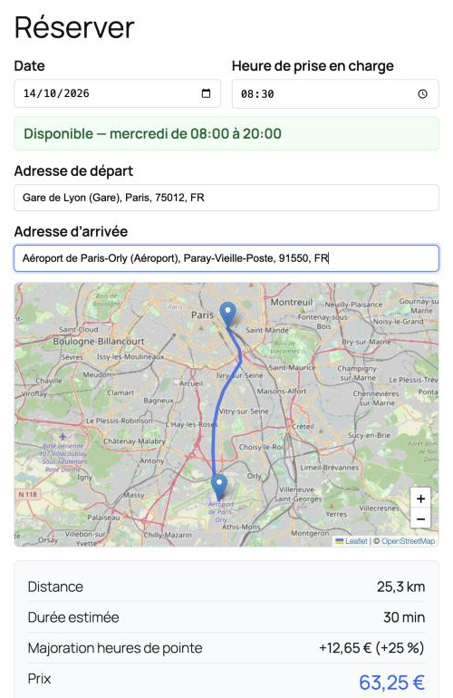
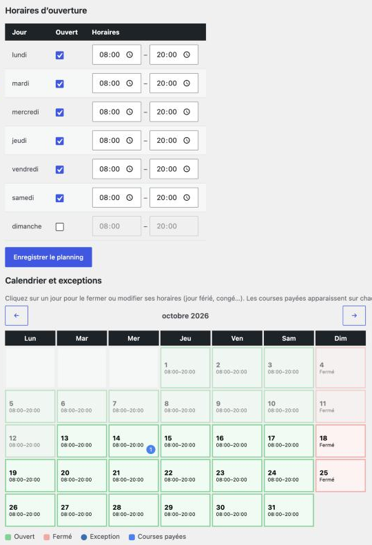

# OSM Ride Booking

Plugin WordPress de réservation de courses pour chauffeurs privés, VTC et navettes : le client saisit ses adresses, voit l'itinéraire sur une carte OpenStreetMap et le prix calculé au kilomètre, puis paie via WooCommerce.

Sans API Google : la carte, la recherche d'adresse et le calcul d'itinéraire reposent sur OpenStreetMap, Nominatim et OpenRouteService (clé gratuite).

| Formulaire de réservation | Disponibilités dans l'admin |
|---|---|
|  |  |

*Captures réalisées sur un site de démonstration local, avec des données fictives.*

## Fonctionnalités

- **Recherche d'adresse** avec autocomplétion (gares, aéroports et arrêts reconnus), utilisable au clavier
- **Itinéraire et distance** routière affichés sur une carte Leaflet
- **Prix au kilomètre** : tarif standard, tarif longue distance au-delà d'un seuil, prix minimum
- **Majoration heures de pointe** optionnelle : pourcentage, jours, créneaux horaires, jours fériés français exclus, et zone géographique facultative (GeoJSON)
- **Disponibilités** : planning hebdomadaire, exceptions par date (congés, jours fériés), blocage automatique des créneaux déjà payés avec une marge réglable
- **Synchronisation iCal** privée vers Google Agenda, Calendrier Apple ou Outlook
- **Paiement WooCommerce** : un produit caché porte chaque réservation ; les détails de la course figurent dans le panier, la commande et les e-mails
- **Mention légale** configurable (par exemple la justification de réservation préalable exigée des VTC en France)
- Compatible avec le stockage des commandes HPOS et les blocs panier / validation de commande
- Traduit en **français** ; textes sources en anglais

## Sécurité

- Le **prix est toujours recalculé côté serveur** à partir d'un itinéraire recalculé : une distance ou un prix envoyés par le navigateur sont ignorés
- La clé OpenRouteService reste sur le serveur (les appels passent par WordPress)
- Toutes les requêtes AJAX sont protégées par nonce ; les actions d'administration exigent le droit `manage_woocommerce`
- Le flux iCal n'est accessible qu'avec un jeton secret, régénérable

## Installation

1. Copier le dossier dans `wp-content/plugins/` et activer **OSM Ride Booking** (WooCommerce requis)
2. Créer une clé gratuite sur [openrouteservice.org](https://openrouteservice.org) et la saisir dans **WooCommerce → Réservation de courses**
3. Régler les tarifs, les horaires et, si besoin, la majoration et la mention légale
4. Ajouter le shortcode `[osm_ride_booking]` sur une page

Prérequis : WordPress 6.0+, PHP 7.4+, WooCommerce 7.0+.

## Pour les développeurs

| Filtre | Rôle |
|---|---|
| `orb_tile_layer` | Changer le fond de carte (`url`, `attribution`) |
| `orb_map_center` | Vue initiale de la carte (`lat`, `lng`, `zoom`) |
| `orb_peak_holidays` | Dates (Y-m-d) sans majoration |

Le formulaire peut être personnalisé en copiant `templates/booking-form.php` dans `votre-theme/osm-ride-booking/booking-form.php`. La couleur d'accent se change avec la variable CSS `--orb-accent`.

```
includes/class-orb-pricing.php       Calcul du prix (logique pure, testée)
includes/class-orb-peak.php          Majoration, jours fériés, zone GeoJSON (logique pure, testée)
includes/class-orb-routing.php       OpenRouteService et Nominatim, avec cache
includes/class-orb-availability.php  Horaires, exceptions, conflits, flux iCal
includes/class-orb-woocommerce.php   Panier, prix serveur, commande, mention légale
includes/class-orb-settings.php      Page de réglages et calendrier
```

## Tests

```bash
php tests/run-tests.php
```

35 tests couvrent le calcul du prix, les créneaux, les jours fériés (Pâques, Ascension, Pentecôte) et la détection de zone.

## Données personnelles

Les adresses saisies par les clients sont envoyées à Nominatim (OpenStreetMap) pour l'autocomplétion et, sous forme de coordonnées, à OpenRouteService pour l'itinéraire. Mentionnez-le dans votre politique de confidentialité. Les tuiles de carte sont chargées depuis `tile.openstreetmap.org` (filtre `orb_tile_layer` pour un autre fournisseur) ; respectez leurs [conditions d'utilisation](https://operations.osmfoundation.org/policies/tiles/).

## Auteur

**Mamadou Alimou Barry** — [mondobarry.com](https://mondobarry.com)

## Licence

GPL v2 ou ultérieure — voir [LICENSE](LICENSE). Leaflet est inclus sous licence BSD 2-Clause (`assets/vendor/leaflet/LICENSE`). Données cartographiques © contributeurs OpenStreetMap.
